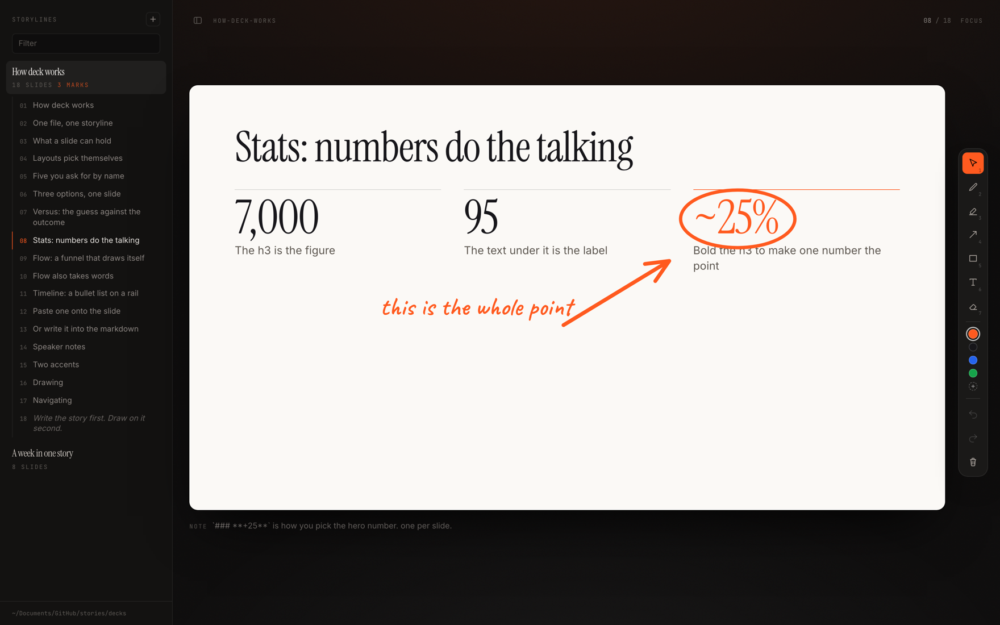
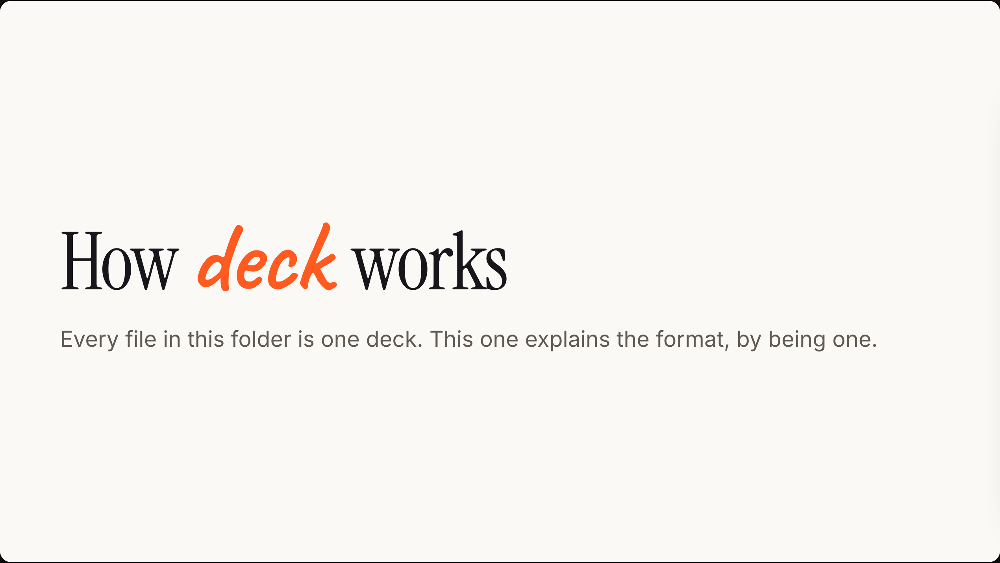
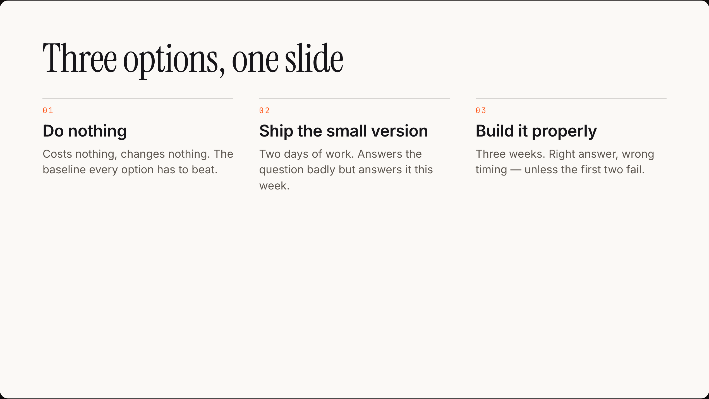
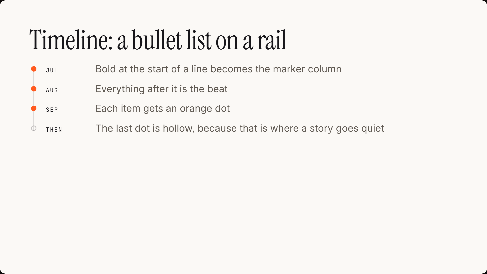
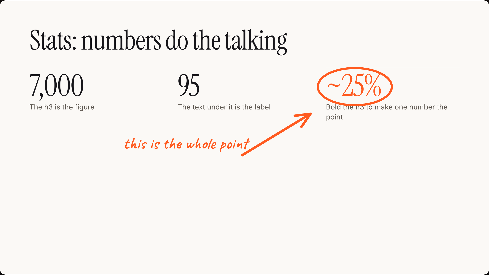

# deck

**PowerPoint for agents.** Your agent writes the deck as plain markdown. You open it and draw on it while you record.

No account, no cloud, no binary format. The deck is a file on your disk that you can edit in any editor, and it stays yours.



```bash
git clone https://github.com/bassotov/deck.git
cd deck
npm install
npm run build
npm link             # puts `deck` on your PATH

deck ~/Notes/Decks   # opens your browser
```

Or `npm run dev` inside the clone, which opens the two example decks in `decks/`.

> Going to npm as `@bassotov/deck` shortly, so this becomes `npx @bassotov/deck ~/Notes/Decks` with no clone at all.

## What it does

**Markdown in, slides out.** One file is one deck, slides split by `---` on its own line. No binary format, no editor lock-in.



**Layouts pick themselves.** A heading on its own centres. A blockquote becomes a pull quote. Everything else gets the house shape: title on top, content below, air underneath.



Ask for `columns`, `stats`, `flow`, `timeline`, `versus` or `image` by name when you want them. They all read the same shape, so learning one teaches you the rest.



**Draw on the slide while you talk.** Pen, highlighter, arrow, shapes, text, eraser. Vector rather than pixels, so a mark stays crisp at any window size and survives a resize.



**Tuned for a trackpad, not a stylus.** Stroke width comes from velocity, jitter is smoothed hard, and Shift snaps to a straight line.

**Paste a screenshot straight onto a slide.** It floats over the slide instead of pushing the text around. Drag it, resize it, undo it.

**Marks save themselves,** per slide, and survive a reload. The example deck ships with a few on it, so you can see the ink layer before you draw anything.

## Why I built it

I record build-in-public videos every week, and every deck tool I tried was built for a room instead of a screen recording.

Keynote wanted me in Keynote. The web ones wanted an account and a subscription, and my slides ended up in someone else's database. Both of them made drawing on a slide a whole mode I had to remember how to enter.

What I actually wanted was to write the story as a text file, the same place I write everything else, and then have something to scribble on while I talked over it. So the markdown stays a plain file you can edit anywhere, and the drawing sits on top and never touches it.

The default slide is title on top, content below, air underneath. Short slides leave the bottom empty on purpose. That is the shape, not a bug to fix ;)

## Write a storyline

`decks/how-deck-works.md` is the reference deck, and it documents the format by being written in it. Open the app and read it there.

The short version:

````markdown
# Title slide

Everything before the first `---` is the title.

---

<span class="eyebrow">day 42</span>

## A normal slide

Headings, **bold**, `code`, lists, tables, quotes, images.

<!-- note: speaker note. renders under the stage, outside the recording crop. -->

---

<!-- layout: stats -->

## Numbers do the talking

### 7,000

The h3 is the figure

### **~25%**

Bold one to make it the point
````

Two accents, both optional: `<span class="hand">handwritten</span>` and `<span class="eyebrow">mono label</span>`.

## Keys

`1` cursor · `2` pen · `3` highlighter · `4` arrow · `5` shape · `6` text · `7` eraser

Press `5` again to cycle square → oval → triangle → line. Letters work too (`V P H A S T E`).

| | |
| --- | --- |
| `← →` `space` scroll | Move through slides |
| Shift while drawing | Snap to a straight line |
| `⇧1`–`⇧4` · `C` | Pick a colour · cycle it |
| `⌘A` `⌘C` `⌘V` `⌘D` | Select all, copy, paste, duplicate |
| `⌘]` `⌘[` | Bring to front, send to back |
| `⌘Z` `⇧⌘Z` · `X` | Undo, redo · clear the slide |
| `⌘B` · `F` · `Esc` | Sidebar · focus mode · back out one step |

Arrows nudge whatever is selected and only move slides when nothing is. `space`, `j` and `k` always move, so advancing mid-recording never depends on remembering to hit `Esc` first.

## Configuration

Both are optional, and both have a CLI flag that wins over them — an explicit `deck ~/notes` is never overridden by an env file left in the working directory. Set them in the shell, or in a `.env.local` (gitignored) next to where you run `deck`.

| | |
| --- | --- |
| `DECKS_DIR` | Folder to read decks from. Default `./decks`. |
| `ASSET_ROOT` | Widens image lookup by bare name to a whole notes folder, the way Obsidian resolves `![[shot.png]]`. Must be a parent of `DECKS_DIR`. Default: `DECKS_DIR` itself. |

```bash
DECKS_DIR=~/Notes/Decks npm run dev
```

Keeping decks outside the repo is the point if you already write in Obsidian, iCloud, or anything synced. The app only ever reads your `.md` files. Annotations go beside them in a `.ink/` dot-folder, and pasted images in `images/`.

## Export to PNG

Every image in this README came out of the deck itself:

```bash
npm i -D playwright && npx playwright install chromium
npm run export                          # every slide of every deck
npm run export -- how-deck-works        # one deck
npm run export -- how-deck-works 0,7    # particular slides, 0-indexed
npm run export -- how-deck-works --app  # the whole window, not just the stage
```

PNGs land in `exports/` at 2×, annotations included. Playwright is not a dependency, because it pulls a browser down on install and you do not need one to run the app.

## The CLI

```bash
deck [dir]                 serve the decks in dir           (default ./decks)
deck new <name> [dir]      start a new storyline and open it
deck export [args…]        render slides to PNG
deck mcp [dir]             run the MCP server on stdio

  -p, --port <n>           port to serve on                 (default 5290)
  -h, --host <host>        host to bind                     (default 127.0.0.1)
      --asset-root <dir>   widen image lookup to this folder
      --no-open            do not open a browser
```

It binds to localhost and serves off your own disk. Nothing is uploaded, and there is no account.

## Let an agent write the deck

`deck mcp` is an MCP server, so Claude (or anything else speaking MCP) can build a deck for you, and you then open it, fix it, and draw on it. The output is a markdown file you own, not a blob inside someone's product.

### Claude Desktop, one click

Grab `deck-x.y.z.mcpb` from [Releases](https://github.com/bassotov/deck/releases), then **Settings → Extensions → Install Extension** and pick it. It asks for the folder your decks live in and that is the whole setup. The bundle carries its own dependencies, so it does not care whether you have ever run npm.

Build one yourself with `npm run bundle`.

### Claude Code

```bash
claude mcp add deck -- deck mcp ~/Notes/Decks
```

### Anything else

```json
{
  "mcpServers": {
    "deck": { "command": "deck", "args": ["mcp", "~/Notes/Decks"] }
  }
}
```

| Tool | What it does |
| --- | --- |
| `deck_syntax` | The whole format: layouts, the blocks each one expects, accents, notes, images |
| `list_decks` | Every deck, with titles, slide counts and slide headings |
| `read_deck` | One deck as raw markdown |
| `write_deck` | Write a deck. Refuses to clobber unless you pass `overwrite` |
| `append_slide` | Add one slide to the end, without rewriting the file |
| `open_deck` | Start the viewer and hand back the URL |
| `export_deck` | Render to PNG |

`deck_syntax` exists because the layouts are not guessable. An agent that reads it first writes decks that use `stats` and `timeline` properly; one that does not writes eighteen identical bullet slides.

The write path is deliberately careful: `write_deck` will not overwrite an existing deck unless you say so explicitly, and nothing in the MCP surface deletes anything.

## Where this is going

The CLI, the MCP server and the Claude Desktop extension all landed. What is left:

- [ ] **Publish to npm** so `npx` works with no clone.
- [ ] **A Windows/Linux pass** on the shortcuts, which are written for a Mac keyboard today.
- [ ] **PDF export** alongside PNG, if anyone wants it.

If you want one of these, open an issue and say so, it genuinely helps me pick.

## Notes

- macOS is what this is developed and recorded on. It should run anywhere Node does, but the shortcuts are written for a Mac keyboard.
- Everything runs locally. The deck and annotation APIs read and write your own filesystem, and the server binds to `127.0.0.1` unless you tell it otherwise.
- The app never writes to a `.md` you did not ask it to. Annotations and pasted-image placements live beside your decks in `.ink/`, so your markdown stays yours.
- `CLAUDE.md` in the repo root is the working reference for the internals, including why a lot of the fiddly interaction decisions went the way they did. It is written for an agent but it reads fine as a design doc.

## License

MIT
